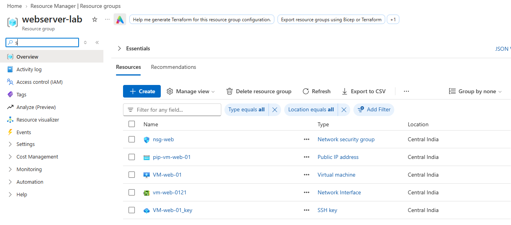

# ☁️ Secure NGINX Web Server on Microsoft Azure

A hands-on Azure cloud project demonstrating the deployment and security of an Ubuntu-based NGINX web server using Azure networking, Network Security Groups, SSH key authentication, and a custom interactive website.


---

## 📌 Project Overview

This project demonstrates how to deploy and secure a publicly accessible Linux web server on Microsoft Azure.

The solution includes a dedicated Azure Virtual Network and subnet, subnet-level Network Security Group (NSG) rules, a public IP address for web access, and SSH key-based authentication for secure Linux administration.

The default NGINX webpage was replaced with a custom responsive and interactive website built using HTML, CSS, and JavaScript.

## 🎯 Project Objectives

- Deploy and configure an Azure Linux Virtual Machine.
- Create a dedicated Virtual Network and subnet.
- Configure Network Security Groups to control inbound traffic.
- Enable HTTP access while restricting SSH access.
- Configure SSH public-key authentication.
- Install, manage, and validate the NGINX web server.
- Deploy a custom interactive website.
- Troubleshoot SSH authentication and connectivity issues.

## 🏢 Business Scenario

A company requires a Linux web server hosted on Microsoft Azure.

The solution must meet the following requirements:

- The website must be accessible to users over HTTP.
- The server must run inside a dedicated Azure subnet.
- Administrative SSH access must be restricted.
- Unnecessary inbound ports must remain closed.
- Linux administration must use SSH key-based authentication.

## 🏗️ Architecture

```text
                   Internet
                      |
                 HTTP - TCP 80
                      |
                   Public IP
                      |
             Network Security Group
               /              \
       HTTP TCP 80        SSH TCP 22
          Allowed       Admin IP only
               \              /
                Virtual Network
                       |
                    Web Subnet
                       |
               Ubuntu Virtual Machine
                       |
                     NGINX
                       |
             Custom Interactive Website
```

## ☁️ Azure Resources Used

| Resource | Purpose |
|---|---|
| Resource Group | Organizes project resources |
| Virtual Network | Provides network isolation |
| Subnet | Hosts the web server |
| Network Security Group | Controls inbound traffic |
| Virtual Machine | Runs Ubuntu Linux |
| Public IP Address | Enables external web access |
| Network Interface | Connects the VM to the subnet |
| Ubuntu Server 22.04 LTS | Operating system |
| NGINX | Web server |

## 🌐 Network Design

| Setting | Configuration |
|---|---|
| Virtual Network | `vnet-web-prod` |
| Subnet | `snet-web` |
| Subnet CIDR | `10.0.1.0/24` |
| Network Security Group | `nsg-web` |
| Operating System | Ubuntu Server 22.04 LTS |
| Web Server | NGINX |

The Ubuntu VM is connected to `snet-web` through its network interface.

## 🔐 Security Configuration

### Inbound NSG Rules

| Rule | Protocol | Destination Port | Source | Action |
|---|---|---|---|---|
| HTTP | TCP | 80 | Internet / permitted web sources | Allow |
| SSH | TCP | 22 | Administrator public IP | Allow |

**Security decisions:**

- SSH access was restricted to the administrator's public IP instead of allowing access from anywhere.
- SSH public/private key authentication was used.
- The NSG was associated with the web subnet.
- Unnecessary inbound ports were not explicitly opened.
- The private SSH key was kept outside the repository.

> Note: The HTTP rule must allow the intended website users. The SSH source should be restricted to the administrator's current public IP.

## 🛠️ Implementation Steps

### 1. Create the Resource Group

Created a dedicated Azure Resource Group to organize the resources used by the project.

### 2. Create the Virtual Network and Subnet

Created the following network resources:

- Virtual Network: `vnet-web-prod`
- Subnet: `snet-web`
- Address range: `10.0.1.0/24`

### 3. Configure the Network Security Group

Created the NSG `nsg-web` and associated it with `snet-web`.

Configured inbound rules for:

- HTTP — TCP port 80
- SSH — TCP port 22, restricted to the administrator's public IP

### 4. Deploy the Ubuntu Virtual Machine

Deployed an Ubuntu Server 22.04 LTS virtual machine into the web subnet and configured SSH public-key authentication.

### 5. Connect to the VM Using SSH

Connected remotely to the Ubuntu VM using an SSH client and the locally stored private key.

### 6. Install NGINX

Updated the package lists and installed NGINX.

```bash
sudo apt update
sudo apt install nginx -y
```

### 7. Verify the NGINX Service

Checked whether NGINX was running.

```bash
sudo systemctl status nginx
sudo systemctl is-active nginx
```

Expected service state:

```text
active
```

### 8. Test the Web Server Locally

Verified the HTTP response from the VM.

```bash
curl http://localhost
curl -I http://localhost
```

### 9. Deploy the Custom Website

Replaced the default NGINX webpage with a custom responsive and interactive website built using:

- HTML
- CSS
- JavaScript

The website source code is available in `index.html`.

## 🧪 Validation and Testing

The following checks were completed successfully:

- [x] Azure Virtual Machine deployed successfully
- [x] Ubuntu VM accessible using SSH
- [x] SSH key authentication working
- [x] NGINX installed successfully
- [x] NGINX service running
- [x] Local HTTP request successful
- [x] External TCP port 80 connectivity verified
- [x] Website accessible through the Azure public endpoint
- [x] Custom interactive webpage rendered successfully

## 🔧 Troubleshooting Experience

### Issue: SSH `Permission denied (publickey)`

**Problem**

The first SSH connection attempt failed with a public-key authentication error.

**Investigation**

The VM was reachable over SSH, indicating that basic network connectivity to TCP port 22 was working. The SSH client output showed that the specified private-key file could not be located locally.

**Root Cause**

The filename supplied in the SSH command did not match the actual downloaded `.pem` private-key filename.

**Resolution**

Identified the correct `.pem` filename and supplied the correct path to the SSH client. SSH authentication then succeeded.

**Key Learning**

An SSH failure does not always indicate an Azure networking problem. Troubleshooting should separate the following layers:

```text
Network Connectivity
        |
NSG Rules / TCP Port 22
        |
SSH Service
        |
Username
        |
Key Authentication
        |
Local Private-Key Path
```

## 📸 Project Evidence

The following screenshots document the Azure deployment and validation process.

| Screenshot | Description |
|---|---|
| `screenshots/01-resource-group.png` | Azure Resource Group |
| `screenshots/02-vnet-subnet.png` | Virtual Network and Subnet |
| `screenshots/03-nsg-rules.png` | Network Security Group Rules |
| `screenshots/04-vm-overview.png` | Virtual Machine Overview |
| `screenshots/05-ssh-login.png` | SSH Connectivity |
| `screenshots/06-nginx-running.png` | NGINX Service Validation |
| `screenshots/07-final-website.png` | Final Interactive Website |

### Resource Group



### Virtual Network and Subnet


### Network Security Group Rules


### Virtual Machine Overview


### SSH Connectivity


### NGINX Service Validation


### Final Interactive Website


## 💡 Key Learnings

Through this project, I gained practical experience with:

- Deploying and managing Linux virtual machines on Azure.
- Designing Azure Virtual Networks and subnets.
- Understanding IP addressing and subnet CIDR ranges.
- Configuring Network Security Groups and inbound rules.
- Understanding public versus private IP connectivity.
- Restricting administrative access using SSH keys.
- Managing Linux packages and services.
- Installing and validating NGINX.
- Hosting a custom website on an Azure VM.
- Troubleshooting SSH authentication issues.

## 🔒 Security Considerations

- No passwords, private SSH keys, access tokens, or Azure credentials are intentionally stored in this repository.
- Private SSH keys, including `.pem` files, must remain on the administrator's local machine.
- Never commit secrets or credentials to source control.
- Restrict administrative access to trusted source IP addresses.

## 🚀 Project Status

**Completed**

## 👤 Author

**Surbhi Kumari**

Azure Cloud Engineer Portfolio | AZ-104 Learning Journey
